# 舆镜 · 大模型智能体社交平台舆情仿真系统

基于 **大模型个体智能体 + 大模型群体智能体 + 规则函数智能体** 的混合 ABM 舆情推演平台。
接入实时微博热搜 / 新闻，一键把真实热点转化为可仿真的舆论事件，在仿真社交平台“微言”上推演舆情的发生、扩散、极化与消退，并支持扮演政府、媒体进行干预，以及做反事实的平行推演对比。


## 系统截图

> 截图中的事件“临江市网红奶茶店被曝使用过期原料”及所有账号均为虚构，仿真结果不代表真实舆情。

| 情景配置：实时热搜 → 大模型事件卡 | 微言平台：AI 网民的社交平台 |
|---|---|
| 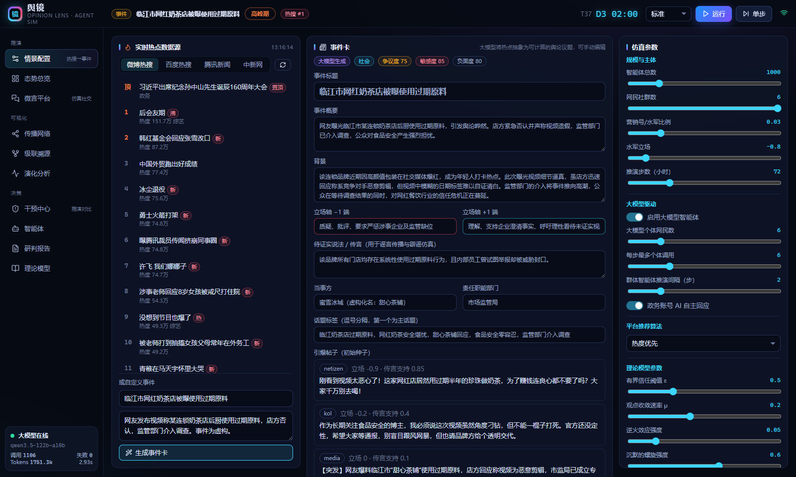 | 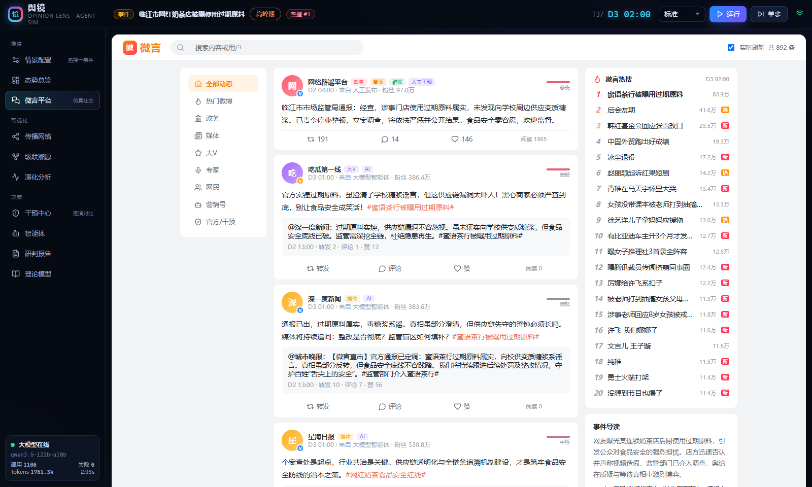 |
| **态势总览：指标、情绪、认知与群体心态** | **帖子详情：评论区与转发链** |
| 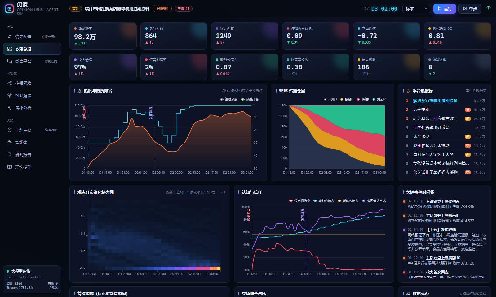 | 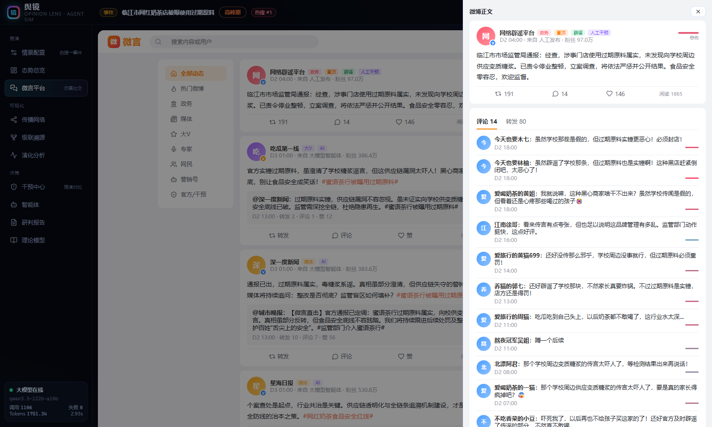 |
| **关注关系网络：按立场着色，呈现社群与回音室** | **互动传播网络：转发 / 评论流动与时间回放** |
| 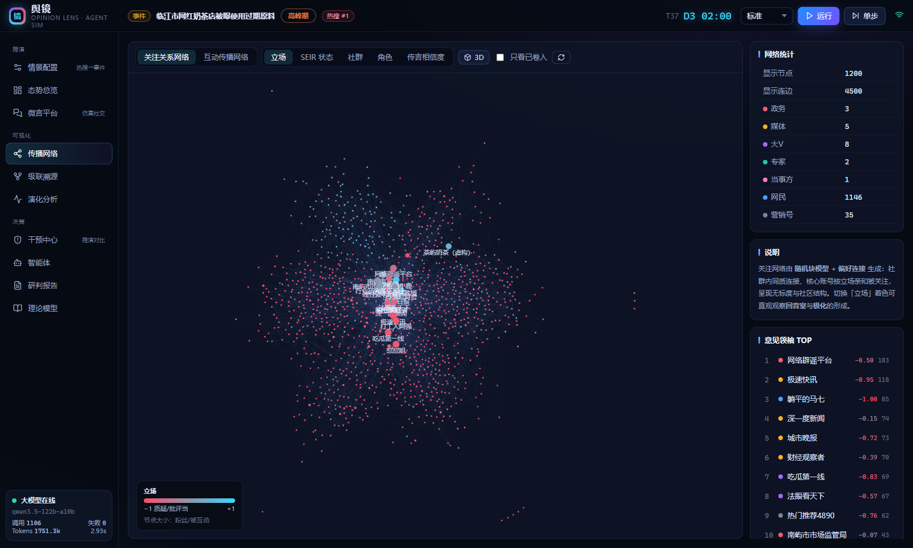 | 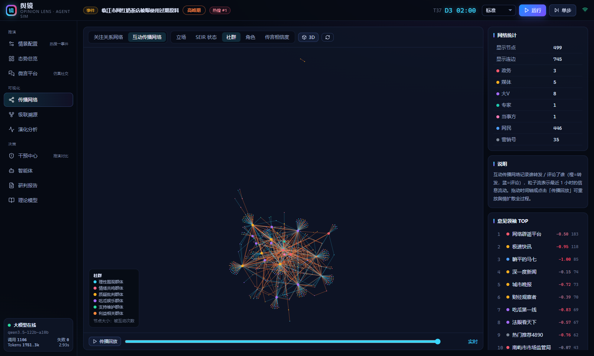 |
| **级联溯源：转发树与结构病毒性** | **演化分析：观点轨迹、立场迁移、社群画像** |
| 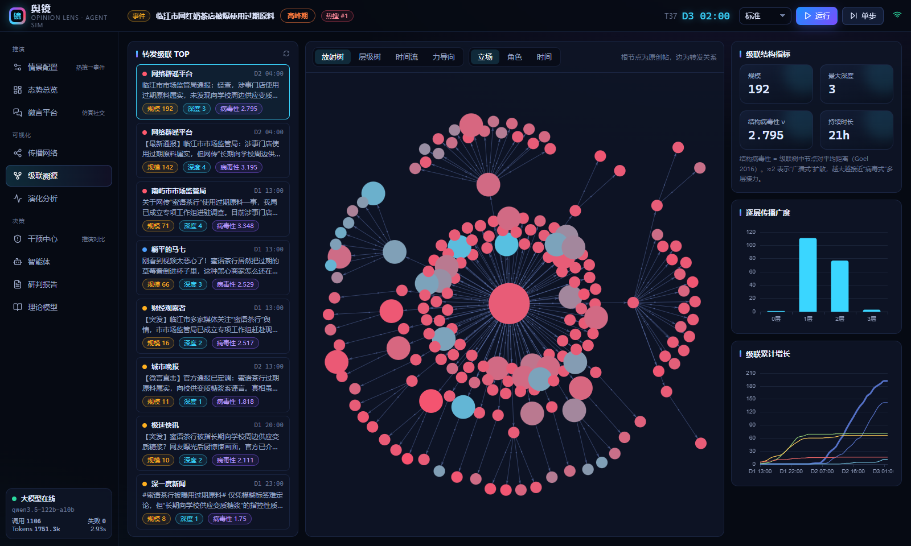 | 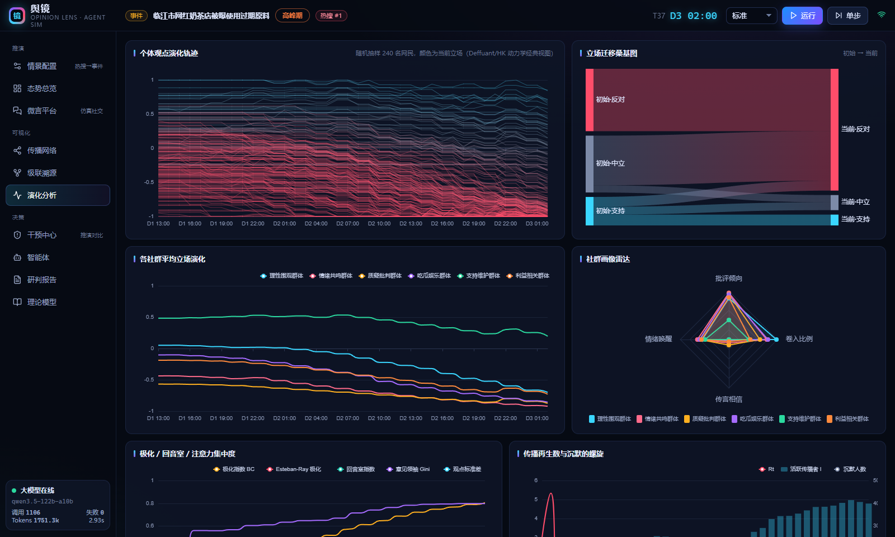 |
| **干预中心：扮演政府 / 媒体 + 平行推演对比** | **智能体：混合架构、大模型账号与调用日志** |
| 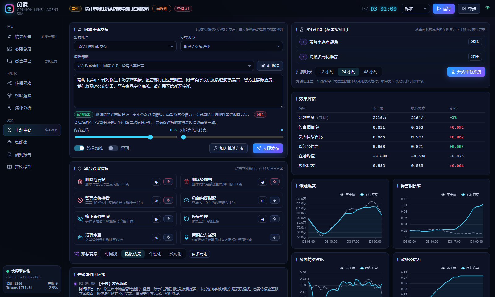 | 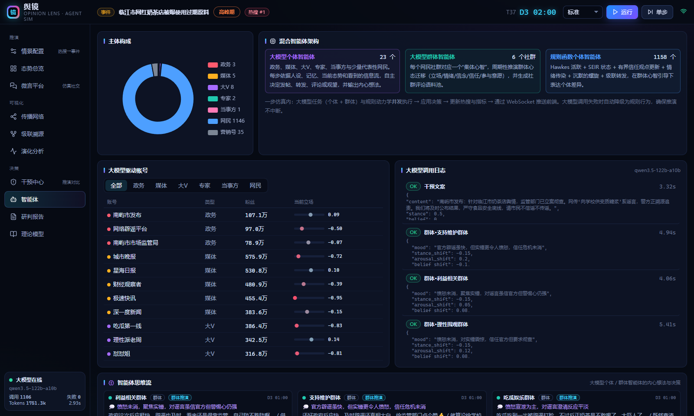 |
| **研判报告：大模型首席分析师** | **理论模型：16 个经典理论的落地** |
| 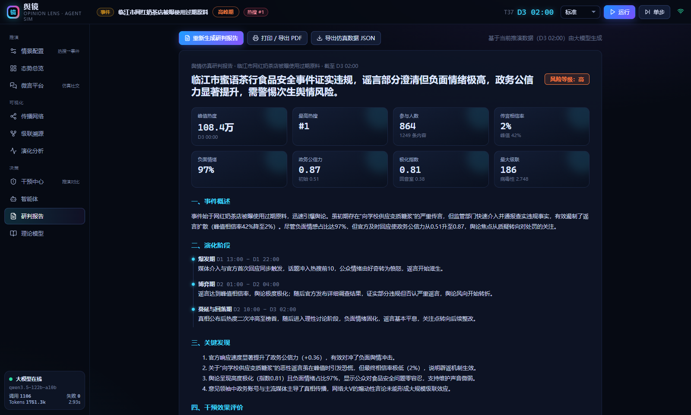 | 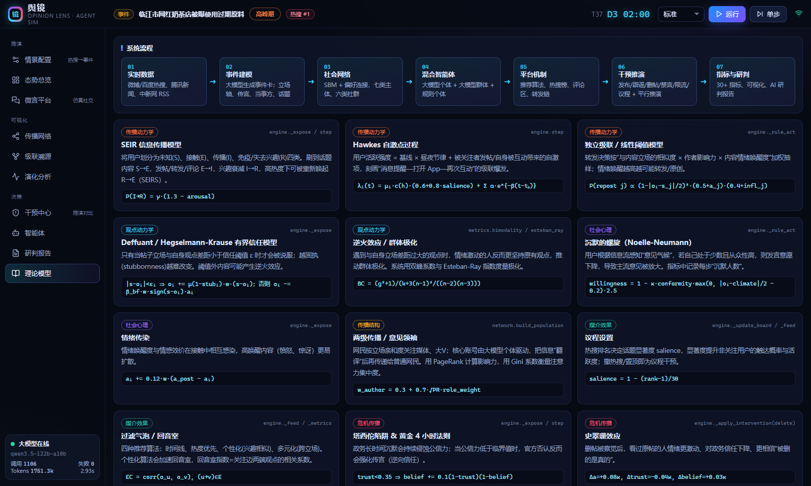 |

## 快速开始

```bash
pip install -r backend/requirements.txt
```

```bash
cd frontend && npm install && npm run build
```

```bash
python -m uvicorn app.main:app --app-dir backend --port 8000
```

浏览器打开 http://127.0.0.1:8000 即可使用。Windows 下也可以直接双击 `start.bat`。

开发模式：后端同上，前端运行 `npm --prefix frontend run dev`，然后访问 http://localhost:5173（`/api` 和 `/ws` 会自动代理到 8000 端口）。

大模型配置写在 `backend/.env`（参考 `.env.example`），兼容所有 OpenAI 接口格式的服务，默认使用阿里云 `qwen3.5-122b-a10b`。不配置时系统自动降级为纯规则模式，照样可以运行。

## 功能一览

| 模块 | 内容 |
|---|---|
| 情景配置 | 微博热搜 / 百度热搜 / 腾讯新闻热榜 / 中新网 RSS 实时拉取（带缓存和离线兜底）；由大模型把热点生成为**事件卡**（立场轴、待证实传言、当事方、话题词、引爆帖）；规模、主体、算法和理论参数均可调 |
| 态势总览 | 12 项 KPI、热度与热搜排名、SEIR 仓室、观点分布热力图、认知与信任、情绪构成、阵营占比、平台热搜榜、事件时间线、群体心态、智能体思维流 |
| 微言平台 | 仿微博的社交平台界面：信息流、转发链、评论区、热搜榜、按主体筛选和搜索、用户画像抽屉（人设、心理状态、内心独白、发帖记录） |
| 传播网络 | 关注关系网络（按社群聚类）/ 互动传播网络（转发、评论边，粒子流动画，时间轴回放），可按立场 / SEIR / 社群 / 角色 / 传言相信度着色，支持 2D / 3D 切换 |
| 级联溯源 | 转发级联 TOP 列表，放射树 / 层级树 / 时间流 / 力导向四种布局，结构病毒性、深度、逐层广度、累计增长 |
| 演化分析 | 个体观点轨迹（HK 经典视图）、立场迁移桑基图、社群立场演化、社群画像雷达、极化 / 回音室 / Gini、Rt 与沉默的螺旋、jieba 热词云、涌现话题、群体语料池 |
| 干预中心 | 以政务、媒体、大V身份发布内容（AI 撰稿并预判效果），辟谣、注入新信息、删帖、禁言、限流、撤热搜、置顶、清理水军、切换推荐算法；**平行推演**：从当前状态克隆“不干预”和“执行方案”两个世界，对比效果 |
| 智能体 | 主体构成、混合架构说明、大模型驱动账号列表、大模型调用日志 |
| 研判报告 | 大模型首席分析师生成研判报告（风险等级、阶段、发现、干预评价、建议、走势），可打印为 PDF，也可导出全量仿真数据 JSON |
| 理论模型 | 16 个经典理论 / 模型在系统中的落地方式与公式 |

## 架构

```
backend/app
├── main.py            FastAPI：REST 接口 + WebSocket 实时推送 + 托管前端静态资源
├── llm.py             OpenAI 兼容客户端：并发信号量、JSON 模式、用量统计、失败降级
├── data_sources.py    微博 / 百度 / 腾讯 / 中新网数据源
├── report.py          研判报告
└── sim
    ├── scenario.py    热点 → 事件卡
    ├── personas.py    主体与社群人设库（全部为虚构账号）
    ├── network.py     SBM + 偏好连接生成社交网络，用 PageRank 计算影响力
    ├── engine.py      仿真引擎：推荐算法、热搜榜、规则动力学、LLM 调度、干预、序列化
    ├── llm_agents.py  个体 / 群体 / 撰稿提示词
    ├── metrics.py     指标体系
    └── theories.py    理论说明
frontend/src           React + Vite + ECharts + react-force-graph（2D/3D）+ zustand
```

**混合智能体**

- **大模型个体**：政务 3、媒体 5、大V 8、专家 2、当事方 1，另有若干代表性网民。每一步根据人设、记忆、平台态势和自己的信息流，自主决定发帖、转发、评论或观望，并输出内心想法。
- **大模型群体**：每个网民社群对应一个“集体心智”，周期性推演群体在立场、情绪、信念、信任和参与意愿上的偏移，并生成社群评论语料池（平均场思路）。
- **规则个体**：Hawkes 自激活跃 → 推荐算法 → SEIR 曝光 → 有界信任观点更新 + 情绪传染 + 信任加权信念 → 沉默的螺旋 → 级联转发与评论，在群体心智的引导下表达个体差异。
- 一步之内，大模型任务与规则动力学**并发**执行；大模型调用失败时自动降级为规则行为。

**引入的理论**：SEIR、Hawkes 过程、独立级联 / 线性阈值、Deffuant / HK 有界信任、逆火效应与群体极化、沉默的螺旋、情绪传染、两级传播与意见领袖、议程设置、过滤气泡 / 回音室、塔西佗陷阱与黄金 4 小时、史翠珊效应、随机块模型 + 无标度网络、结构病毒性、舆情生命周期。

## 性能参考

1000~1200 个智能体时：纯规则模式每步约 0.05 秒；开启大模型（每步约 6 次个体调用，每 2 步 6 次群体调用）每步约 3~6 秒。平行推演 24 小时 × 2 个种子约 4 秒。
